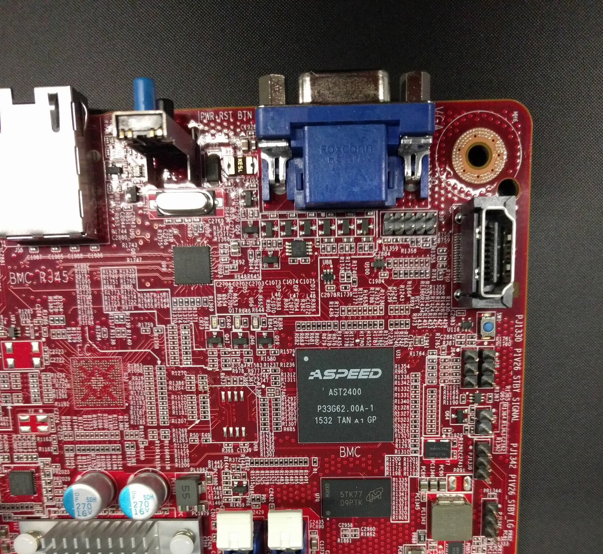
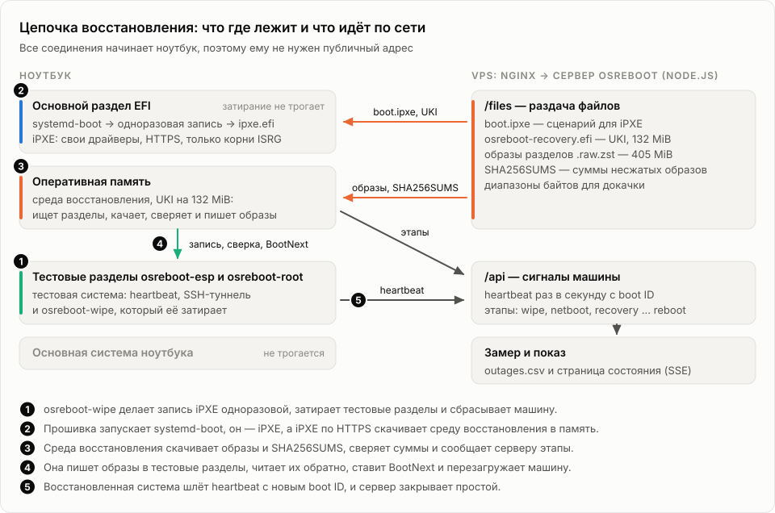
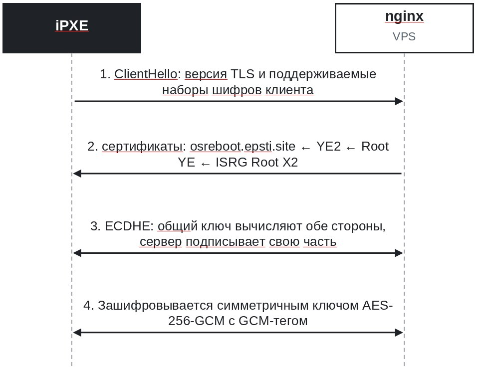
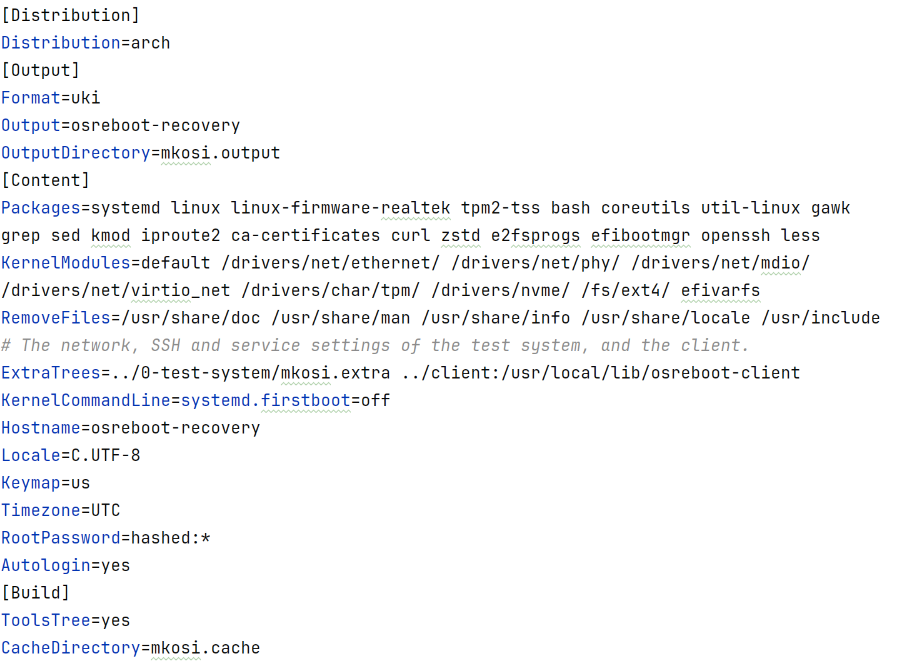
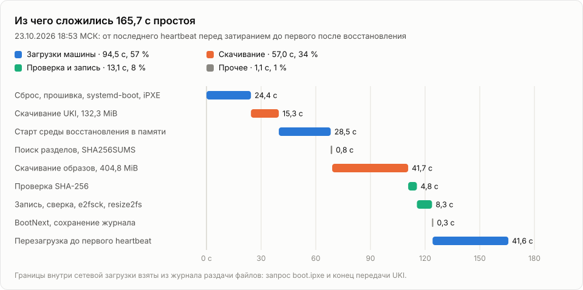

# OSreboot

Проект решает неприятную задачу: что делать, если на удаленной машине слетела операционка, а рядом нет ни человека с флешкой, ни серверного BMC (IPMI/iLO), ни настроенного локального PXE-сервера.

В дата-центрах на платах стоит отдельный контроллер управления (вроде чипа ASPEED на фото ниже), через который можно удаленно смонтировать ISO-образ и перезагрузить питание. На обычных ноутбуках и домашних мини-ПК такого железа нет.

<p align="center">
  
</p>

В **OSreboot** обычный ноутбук восстанавливает себя сам через интернет. На основном EFI-разделе лежит собранный ipxe.efi с поддержкой HTTPS. Когда тестовая система падает (в проекте для этого есть скрипт, который затирает разделы), ноутбук перезагружается в iPXE, получает IP по обычному домашнему DHCP и тянет с внешнего VPS среду восстановления в оперативную память. Оттуда он скачивает чистые образы разделов, проверяет контрольные суммы и разворачивает систему заново.

## Общая схема работы

Вся цепочка рассчитана на работу в чужой или домашней сети, где мы не можем настраивать роутер. На самом ноутбуке остаются только загрузчик systemd-boot и бинарник ipxe.efi со вшитым адресом нашего сервера и корневыми сертификатами Let's Encrypt. Всё остальное приезжает по HTTPS с VPS.

<p align="center">
  
</p>

Когда запускается скрипт сброса osreboot-wipe --apply, он переключает дефолтную запись загрузчика на iPXE, тормозит службу отправки пингов и затирает нулями первые 64 мегабайта тестовых разделов osreboot-esp и osreboot-root. Файловая система и загрузчик тестовой ОС перестают существовать, после чего машина сразу уходит в жесткий ребут через sysrq.

При старте материнская плата запускает systemd-boot, а тот сразу передает управление в iPXE. Загрузчик поднимает сеть по DHCP, резолвит домен сервера (если домашний роутер тупит на первых DNS-запросах, скрипт делает несколько попыток и переключается на 1.1.1.1 / 8.8.8.8) и по HTTPS забирает osreboot-recovery.efi.

<p align="center">
  
</p>

Среда восстановления собрана через mkosi в один UKI-файл (Unified Kernel Image) весом 132 МБ. Внутри одного .efi файла склеены загрузчик systemd-stub, ядро Linux и образ initrd с базовым набором утилит (curl, zstd, dd, e2fsprogs). Эта система целиком разворачивается в оперативке и вообще не монтирует локальный диск.

<p align="center">
  
</p>

Запустившись в RAM, скрипт восстановления находит на диске разделы по меткам osreboot-esp и osreboot-root. Чтобы случайно не снести основную систему на том же SSD, он сверяет размеры разделов и типы файловых систем. Затем качает сжатые .zst образы с сервера. Если интернет моргнет, curl -C - докачает файл с места обрыва.

Перед записью архивы распаковываются на и сразу сверяются с SHA256SUMS. После того как dd запишет данные на разделы, скрипт вычитывает записанные блоки обратно с физического диска и считает хеш еще раз. Если всё сошлось, выставляется одноразовая метка BootNext на новую систему, и ноутбук уходит в ребут.

Восстановленная система (тоже собранная через mkosi) стартует с диска, первым делом снимает дефолтную загрузку в iPXE и начинает раз в секунду слать heartbeat на сервер. Увидев пинг с новым boot ID, сервер понимает, что машина ожила, и закрывает простой.

## Мониторинг и замеры времени

На VPS крутится небольшой сервис на Node.js и веб-морда. Пока ноутбук работает штатно, он каждую секунду шлет POST-запрос на /api/heartbeat. Если пингов нет дольше трех секунд, сервер открывает инцидент простоя, а во время восстановления принимает от ноутбука статусы текущего этапа (wipe, netboot, download, verify, write, reboot) и рисует прогресс в браузере через Server-Sent Events.

<p align="center">
  
</p>

По графику хорошо видно, куда на самом деле уходит время. Сама проверка SHA-256 и запись на NVMe-диск занимают всего **13 секунд**. Скачивание 132 МБ среды восстановления и 405 МБ сжатых образов системы заняло 57 секунд — тут всё уперлось в 100-мегабитный линк ноутбука (около 11 МБ/с). А больше половины всего времени простоя (**94,5 секунды**) съели две аппаратные перезагрузки ноутбука: инициализация UEFI, старт ядра и поднятие сети. В виртуальной машине QEMU/OVMF, где прошивка стартует мгновенно, этот же цикл проходит за **54–65 секунд**.

## Что внутри репозитория

Весь код разбит по шагам цепочки загрузки:

```
OSreboot/
  0-test-system/   # Конфиг mkosi для сборки целевой системы (Arch Linux) и скрипт разметки
  1-wipe/          # Скрипт osreboot-wipe: переключает загрузчик на iPXE и затирает разделы
  2-ipxe/          # Сборка кастомного ipxe.efi с HTTPS, сертификатами ISRG и скриптом osreboot.ipxe
  3-recovery/      # Сборка UKI-образа среды восстановления (osreboot-recovery.efi), работающей в RAM
  client/          # Скрипт osreboot-client (sh + curl) для отправки heartbeat и этапов
  server/          # Сервер на Node.js, дашборд состояния и конфиги для деплоя (nginx, systemd)
  extra/           # Графики, результаты замеров (CSV/JSON) и материалы презентации
```

## Сборка и запуск

### Серверная часть

Для запуска сервера нужен Node.js 24+. Сначала создаем конфиг устройств и прописываем туда SHA-256 хеш токена нашего ноутбука:

```bash
openssl rand -hex 32 | tr -d '\n' > laptop.token
sha256sum laptop.token
cp server/config/devices.example.json server/config/devices.json
```

Собираем и запускаем сервер (по умолчанию слушает 127.0.0.1:8090, наружу смотрит через nginx):

```bash
npm ci
npm run build && npm start
```

Готовые образы и загрузочный скрипт boot.ipxe кладутся в каталог server/files/.

### Сборка iPXE и образов системы

Сборка сетевого загрузчика ipxe.efi под ваш домен и установка его на основной EFI-раздел машины:

```bash
bash 2-ipxe/build.sh osreboot.example.org
sudo bash 2-ipxe/install-ipxe.sh 2-ipxe/out/ipxe.efi --apply
```

Сборка тестовой системы (0-test-system) и RAM-среды восстановления (3-recovery) через mkosi:

```bash
mkosi -C 0-test-system build
cd 0-test-system/mkosi.output
zstd -T0 -12 osreboot-test.esp.raw osreboot-test.root-x86-64.raw
sha256sum osreboot-test.esp.raw osreboot-test.root-x86-64.raw > SHA256SUMS
cd ../..

mkosi -C 3-recovery build
```

Чтобы в публичных образах не светились секреты, токен для отправки пингов и ключи для обратного SSH-туннеля зашифрованы через чип TPM2 самого ноутбука (systemd-creds encrypt -T) и лежат в /etc/credstore.encrypted/ — расшифровать их может только эта конкретная плата.

### Запуск демонстрации

Когда тестовая система запущена на ноутбуке, проверить готовность к сбросу и запустить полное переразвертывание по сети можно одной командой:

```bash
osreboot-wipe           # сухой прогон: проверит разделы, наличие iPXE и выведет план
osreboot-wipe --apply   # затрет разделы и отправит машину на восстановление через сеть
```